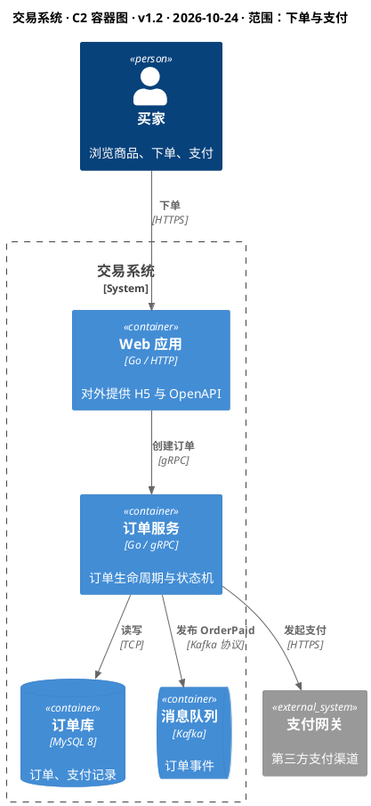
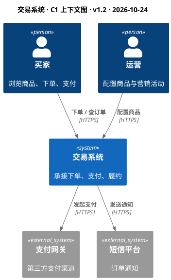

<!--
 * @Author: shgopher shgopher@gmail.com
 * @Date: 2026-10-24 15:45:00
 * @LastEditors: shgopher shgopher@gmail.com
 * @LastEditTime: 2026-10-24 15:45:00
 * @FilePath: /luban/v2/附录/80-架构文档与表达/80.1-C4模型.md
 * @Description: 
 * 
 * Copyright (c) 2026 by shgopher, All Rights Reserved. 
-->
# 80.1 C4 模型

## 一句话

> C4 用四个缩放层级 (Context / Container / Component / Code) 画同一个系统，**每一层只回答一类人的一类问题**；实践中 90% 的场景只需要前两层，第四层几乎不用手画。

## 四层：同一个系统的四个缩放级别

| 层级 | 画什么 | 元素 | 读者 | 元素数上限 | 什么时候画 |
|---|---|---|---|---|---|
| **C1 System Context** | 系统、使用者、外部系统 | 人、软件系统 | 所有人（含非技术） | **≤ 15** | 立项、方案评审开场 |
| **C2 Container** | 可独立运行 / 部署的单元 + 数据存储 | 应用、服务、DB、队列、前端 | 开发、运维、架构 | **≤ 20** | 技术方案、交付文档 |
| **C3 Component** | 一个容器内部的组件与依赖 | 组件（一组类 / 模块） | 该容器的开发者 | **≤ 25** | 复杂容器的内部设计 |
| **C4 Code** | 类、接口、方法 | 类图 | 极少（接手者） | — | 关键算法，**通常由工具生成** |

> 🔑 缩放的关键是**同一套元素、不同粒度**：C1 里一个框是 “交易系统”，C2 里它展开成 4 个容器，C3 里其中一个容器再展开成组件。四层不是四个系统，是四个放大倍数。

## “Container” 不是 Docker 容器

这是 C4 被误解最多的一点：

| 误解 | 事实 |
|---|---|
| Container = Docker / K8s Pod | Container = **可独立运行或独立存储数据的单元**：一个进程、一个数据库、一个消息队列、一个浏览器里的 SPA、一个文件系统 |
| 一个 Pod 就是一个 Container | 一个容器可能由多个 Pod 组成（同一服务的多副本），也可能一个 Pod 里跑多个容器 |
| 前端不算容器 | 浏览器里跑的 SPA **是**容器（它独立运行、独立部署） |

判定标准两条，满足其一即可进 C2：

1. **能独立运行、独立部署** (独立进程 / 独立发布单元)；
2. **独立持有数据** (数据库、对象存储、缓存、队列)。

## 各层的判定规则

| 层 | 该画 | 不该画 |
|---|---|---|
| C1 | 你的系统（1 个框）、外部角色、外部系统、交互目的 | 内部组件、技术栈、数据库 |
| C2 | 容器、容器间的调用关系、协议、数据存储 | 类、方法、代码细节、容器内部结构 |
| C3 | 组件、组件间依赖方向、对外接口 | 部署细节（节点、副本数、可用区） |
| C4 | 关键类与接口 | 全部类（那是 IDE 的活） |

## 符号规范：形状本身要说话

| 形状 | 含义 | 备注 |
|---|---|---|
| 人形 | 角色 / 使用者 | 写角色（「买家」），不写具体人 |
| 实线方框 | 本系统的容器 | 边框统一，颜色可标识技术类型 |
| 灰色方框 | 外部系统 | 视觉上必须能一眼区分「我管的」和「别人管的」 |
| 圆柱 | 数据存储（DB / 对象存储） | C4-PlantUML 里是 `ContainerDb` |
| 队列符号 | 消息中间件 | `ContainerQueue` |
| 箭头 | 调用 / 数据流，**带方向** | 标签写「动词 + 协议」：`创建订单 / gRPC` |
| 虚线框 | 系统边界 | 标出「哪些是你负责的」 |

每张图必须有：**图名 + 层级 + 版本 + 日期 + 范围**。没有版本的架构图，半年后没人敢用。

## 代码：C4-PlantUML (可直接渲染)

C1 与 C2 写在同一份源文件里 (依赖 C4-PlantUML 标准库，PlantUML ≥ 1.2020 已内置)：

同一套元素画 C1，只需要 “收起” 系统内部的容器：

> 💡 C1 里**没有数据库**。数据库是内部实现细节，出现在上下文图里说明作者在混层级——这是最容易被评审抓住的错误。

## 什么时候不用 C4

| 你想表达 | 该用什么 |
|---|---|
| 数据怎么流动、怎么加工 | 数据流图（DFD）/ 数据架构图（46.1） |
| 部署在哪些节点、可用区、网络分区 | 部署图（C4 有 Deployment 图作为补充） |
| 一次请求的时序 | 时序图（80.3） |
| 状态流转 | 状态机图（80.3） |
| 单个脚本 / 单服务小工具 | 一张上下文图足够，别硬凑四层 |

## 反模式

| 反模式 | 后果 |
|---|---|
| 把 C2 画成类图 | 读者是来做技术决策的，看到 60 个类直接放弃 |
| 一张图混多层（上下文里塞数据库和缓存） | 抽象层级混乱，谁看都不对 |
| 元素超过 20 个还硬塞一张 | 认知负荷超限，读者只能「看个大概」 |
| 图里只写技术，不写职责 | 读者知道「用了 Kafka」，不知道「为什么需要它」 |
| 没有版本 / 日期 / 图例 | 半年后无法判断是否过期，于是没人敢信 |
| 手画 C4 代码层（C4） | 与代码不同步，一周就过期；应由工具生成 |
| 用截图代替源文件 | 无法 diff、无法多人改、无法批量更新 |
| 图与代码两套事实 | 新人按图理解，上线踩坑 |

## 自检

**Q1** 评审会上有人问 “为什么 C1 里没有数据库？我们明明有 MySQL”。你怎么回答，并说明如果加上会破坏什么？

▸ 答案：C1 的读者包括非技术方，它只回答 “这个系统为谁解决什么问题、依赖哪些外部系统”。数据库是系统内部的实现选择，对 “系统边界” 这一层没有信息量。加上它会破坏两件事：① **抽象层级一致性**——一旦出现一个内部元素，读者就会期待看到全部内部元素，C1 会退化成一张不完整的 C2；② **边界表达**——C1 的核心是 “哪些是我负责的、哪些是别人负责的”，数据库并不改变系统边界。数据库出现在 C2。

**Q2** 团队用 C4 画了四层图，但每次发版后 C3 和 C4 都过期，新人照着图找不到代码。问题出在哪一层？怎么改？

▸ 答案：问题不在 C4，在**把 “易变的层” 当成 “手工维护的文档”**。C3/C4 的粒度已经接近代码结构，天然随重构变化，手画必然过期。改法：① C1/C2 手工维护 (它们本来就该稳定，半年才改一次)；② C3 只在 “要讲清某个复杂容器的设计” 时画，并标注版本与对应 commit；③ C4 不手画，交给 IDE / 工具从代码生成。原则：**离代码越近的图，越必须从代码生成**。

**Q3** 一个系统有 3 个服务、1 个数据库、1 个缓存、1 个网关、2 个外部系统、2 类用户。你画几张图？

▸ 答案：**两张**。C1 一张 (系统 1 个框 + 2 类用户 + 2 个外部系统 = 5 个元素)，C2 一张 (3 服务 + 1 DB + 1 缓存 + 1 网关 = 6 个容器，加 2 个外部系统 = 8 个元素)。C3 只在某个服务内部真的复杂 (例如订单状态机跨 4 个组件) 时补一张，C4 不画。判据是**读者的决策需要**，不是 “C4 有四层所以要画四张”——图的数量由问题数量决定，不由模型层数决定。
