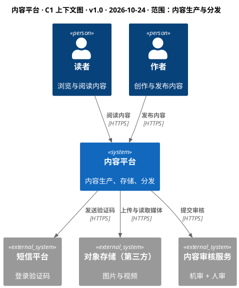
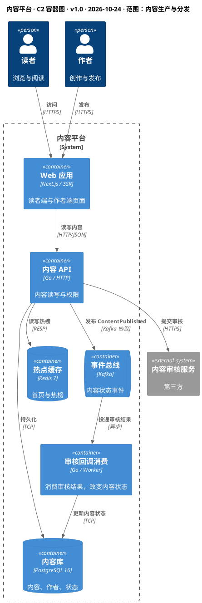
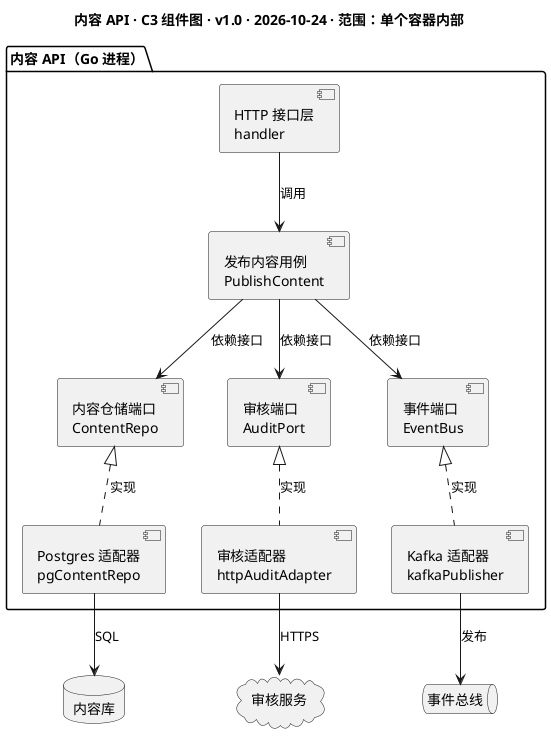

<!--
 * @Author: shgopher shgopher@gmail.com
 * @Date: 2026-10-24 15:45:00
 * @LastEditors: shgopher shgopher@gmail.com
 * @LastEditTime: 2026-10-24 15:45:00
 * @FilePath: /luban/v2/附录/80-架构文档与表达/80.2-架构图规范.md
 * @Description: 
 * 
 * Copyright (c) 2026 by shgopher, All Rights Reserved. 
-->
# 80.2 架构图规范 (上下文图 / 容器图 / 组件图)

## 一句话

> 三张图各回答一个问题：上下文图讲**边界**，容器图讲**部署单元与通信**，组件图讲**职责划分**；一张图只能回答一个问题，塞进第二个问题时它就开始失效。

## 三张图的分工，一次说清

| 图 | 回答的问题 | 必须包含 | 禁止出现 | 读者 | 元素上限 |
|---|---|---|---|---|---|
| **上下文图** | 系统边界在哪、为谁服务、依赖谁 | 系统（1 个框）、角色、外部系统、交互目的 | 数据库、内部组件、技术栈 | 全员（含非技术方） | **≤ 15** |
| **容器图** | 有哪些可部署单元、它们怎么通信 | 容器、数据存储、协议、方向、同步/异步 | 类、方法、代码细节 | 开发、运维、架构 | **≤ 20** |
| **组件图** | 一个容器内部怎么分职责 | 组件、接口、依赖方向 | 节点、副本、可用区 | 该容器的开发者 | **≤ 25** |

三者的关系是**同一个系统的三个缩放倍数**，不是三份不同的文档：上下文图里的一个框，在容器图里展开成若干容器；容器图里的一个框，在组件图里展开成若干组件。

## 上下文图：七条规则

1. **只画一个属于你的系统**，放在中心；画两个就会问 “这两个哪个是主体”。
2. **只画人与外部系统**，不画任何内部元素——数据库、缓存、队列一个都不许出现。
3. **每个箭头标三件事**：谁发起、做什么、用什么协议。
4. **外部系统必须注明归属** (自建 / 第三方)，视觉上标灰。
5. **用虚线框标出系统边界**，让 “我负责什么” 一眼可见。
6. **不写技术栈**。上下文图里出现 “Kafka” 就是混了层级。
7. **元素不超过 15 个**，超了说明你把内部结构画进来了。

正面例子：



反面例子 (一张典型的 “四不像”)：

```
┌──────┐   ┌──────┐   ┌──────┐
│ App  │──▶│ API  │──▶│MySQL │   ← 数据库出现在上下文图
└──────┘   └──────┘   └──────┘
              │
              ▼
           ┌──────┐
           │Redis │            ← 箭头没有标签、没有方向语义
           └──────┘
```

三个错误一次犯全：**混层级** (DB 进来了)、**缺外部角色** (谁在用这个系统？)、**箭头无标签** (读者不知道传什么、用什么协议)。

## 容器图：九条规则

1. **一个可独立运行 / 部署的单元画一个框**：服务、前端应用、Worker、数据库、缓存、队列。
2. **框内三段信息**：名称、职责 (一句话)、技术栈 (`Go / HTTP`、`PostgreSQL 16`)。
3. **数据存储用圆柱**，队列用队列形状，别全用矩形。
4. **箭头必须有方向和标签**，标签写 “动词 + 协议”。
5. **区分同步与异步**：同步标注协议 (HTTP / gRPC)，异步标注 “异步 / 投递”。
6. **只画跨容器调用**，容器内部结构留给组件图。
7. **外部系统标灰**，与本系统视觉区分。
8. **技术版本谨慎写**：只在 “选型就是决策” 时写 (如 `PostgreSQL 16`)，否则容易被版本升级弄成过期图。
9. **元素不超过 20 个**，超了按子域拆成多张图，而不是缩小字号。



这张图能回答的问题：**有 6 个可部署 / 可存储单元；内容 API 是同步入口；审核结果走异步回写；第三方只碰审核，不碰数据**。它不能回答 (也不该回答)：`ContentRepo` 长什么样、用了什么 ORM。

## 组件图：六条规则

1. **只画一个容器的内部**，标题里写清是哪个容器。
2. **组件的粒度是 “可替换”**：一组承担同一职责的类 / 模块，而不是单个类。
3. **依赖方向必须画出来** (谁 import 谁)，这是组件图的核心价值。
4. **标出对外暴露的端口 / 接口**，让 “实现可以被换掉” 这件事在图上可见。
5. **不画部署信息** (节点、副本数、端口号属于部署图)。
6. **元素不超过 25 个**；超过就说明这个容器该拆了。



这张图的价值不在 “有哪些组件”，而在**三个箭头都从用例指向接口，实现箭头从适配器指向接口**——依赖方向一眼可见 (对应 26.3 整洁架构、26.5 六边形)。

## 十二条通用制图规范

| # | 规则 | 为什么 | 怎么检查 |
|---|---|---|---|
| 1 | 一张图一个主题 | 两个主题 = 两种抽象层级 | 图名能不能用一个名词短语概括 |
| 2 | 同一张图不混抽象层级 | 混了之后读者要反复切换上下文 | 是否同时出现「系统」和「类」 |
| 3 | 箭头必须有标签（动词 + 协议） | 裸箭头等于让读者猜 | 随机挑 3 条箭头，能否说清传什么 |
| 4 | 箭头方向 = 调用 / 数据流向，不混用 | 「依赖」和「调用」不是一件事 | 是否存在双向箭头 |
| 5 | 颜色有语义且配图例 | 没有图例的颜色是噪音 | 看图例能否复述每种颜色的含义 |
| 6 | 交叉线尽量少 | 交叉超过 5 处，读者开始放弃 | 数一数交叉点 |
| 7 | 布局方向统一 | 混杂方向破坏阅读顺序 | 全图是左→右还是上→下 |
| 8 | 外部元素统一灰色 | 归属是架构图的第一信息 | 「别人管的」是否一眼可辨 |
| 9 | 数据存储统一形状 | 形状是零成本的语义 | DB / 缓存 / 队列是否同形 |
| 10 | 标题 + 版本 + 日期 + 作者 + 范围 | 没有版本的图没人敢信 | 五项是否齐全 |
| 11 | 不用 3D、阴影、渐变 | 打印变糊、缩小失真 | 灰度打印是否仍然清晰 |
| 12 | 源文件进 Git，截图只作导出物 | 图要能 diff、能多人改 | 仓库里有没有 `.puml` / `.mmd` |

## 元素数量与认知负荷：为什么是 15 而不是 50

| 元素数 | 首次理解时间 | 读者行为 |
|---|---|---|
| 5–9 | 10–30 秒 | 能记住全部元素与关系 |
| 10–15 | 30 秒–1 分钟 | 能抓住主干，细节需对照文字 |
| 16–25 | 2–5 分钟 | 开始跳过、只看想要的框 |
| > 25 | 放弃 | 「大概是这样吧」——等于没画 |

依据是 7±2 的工作记忆容量，加上 “关系” 也占认知槽位：15 个元素 + 20 条关系已经接近一张图的极限。

> 🔑 图不是越全越好。**一张 15 个元素的图被读懂，胜过一张 50 个元素的图被跳过。**

## 命名规范：名字本身就是文档

| 差 | 好 | 原因 |
|---|---|---|
| `Service A` / `服务1` | `订单服务` | 名字要表达业务能力 |
| `DB` | `订单库（MySQL 8）` | 存储要标类型与归属 |
| `调用` | `创建订单 / gRPC` | 动词 + 协议 |
| `系统` | `交易系统` | 具体名词 |
| `用户` | `买家` / `运营` | 角色，不是泛称 |
| `MQ` | `事件总线（Kafka）` | 用途 + 产品 |
| `缓存` | `热点缓存（Redis）` | 缓存什么，决定读者要不要信它 |

## 工具对比：图要能被 diff

| 工具 | 类型 | Git 友好 | 学习成本 | 适合 |
|---|---|---|---|---|
| **PlantUML** | 文本 DSL | ✅ 逐行 diff | 中 | 团队标准化、CI 自动出图 |
| **Mermaid** | 文本 DSL | ✅ | 低 | README / 文档内嵌，GitHub 直接渲染 |
| **Structurizr** | 模型驱动（C4） | ✅ 模型是代码 | 中高 | 多视图一致性（一份模型出多张图） |
| **draw.io** | 图形化 | ⚠️ XML 难 diff | 低 | 一次性汇报、非工程维护 |
| **Excalidraw** | 手绘风 | ⚠️ | 低 | 白板讨论、早期构思 |
| **IcePanel / 企业架构工具** | 模型驱动 | ✅ | 高 | 大型组织架构治理、资产盘点 |

选择原则：**要长期维护的图，必须用文本或模型驱动**；只用一次的图，用什么都行，但别把它当文档。

## 发布前检查清单

- [ ] 图名能说清 “哪个系统 + 哪一层 + 什么范围”
- [ ] 版本、日期、作者齐全
- [ ] 元素数 ≤ 上限 (15 / 20 / 25)
- [ ] 没有跨层级的元素 (上下文图里没有数据库)
- [ ] 每条箭头都有 “动词 + 协议”
- [ ] 没有双向箭头 (有就拆成两条)
- [ ] 外部系统已标灰并注明归属
- [ ] 数据存储形状统一
- [ ] 颜色有图例，或干脆不用颜色
- [ ] 交叉线 ≤ 5 处
- [ ] 灰度打印仍然可读
- [ ] 源文件已提交到仓库，并标明对应版本

## 反模式

| 反模式 | 后果 |
|---|---|
| 箭头不标协议，只写「调用」 | 读者无法判断同步/异步、是否有超时与重试 |
| 双向箭头 | 「A 调 B」和「B 调 A」被合成一个，循环依赖被隐藏 |
| 把调用链和依赖关系画在一起 | 两种语义混淆，改动影响面无法评估 |
| 一个框里塞三个系统 | 边界消失，评审时无法讨论「谁负责」 |
| 图超过一屏还硬塞 | 读者只能看局部，关系推断全部失效 |
| 用截图代替源文件 | 无法 diff、无法批量改，半年后彻底过期 |
| 只画 happy path | 缺降级、重试、异步补偿，读者误以为系统是线性的 |
| 中英混用无规则 | `Order 服务 call 支付 gateway`，读者要二次翻译 |
| 图与代码两套事实 | 新人按图理解，一上手就踩坑 |
| 只画「未来架构」不标现状 | 读者以为已经建成，规划与实现脱节 |

## 自检

**Q1** 你的上下文图有 22 个元素，评审时被要求 “缩到 15 个以内”。该删什么、不该删什么？

▸ 答案：**先删内部元素**——数据库、缓存、队列、内部服务几乎都是被误画进来的，删掉它们往往一次就能降到 15 以下。**不该删的是角色与外部系统**：它们是 “边界” 的定义者，删了图就没有信息量。如果删完仍超限，说明系统承担了多个不相关的职责，应该拆成两张上下文图 (按业务能力分)，而不是继续压缩元素。

**Q2** 容器图上有一条 `Web 应用 → 内容 API → 审核服务` 的链路，但线上偶尔出现 “审核结果回来了，内容状态没变”。按规范，这张图缺了什么信息，导致排查慢？

▸ 答案：缺两类信息：① **同步 / 异步标注**——审核结果是**异步回调** (`mq → job`)，图上如果只画成一条同步箭头，排查者会以为 “API 返回成功就代表状态更新了”；② **失败与重试路径**——回调消费失败会重试、会进死信，这些不在图里，排查者不知道去哪个组件找积压。规范要求 “箭头标协议 + 区分同步异步”，本质是逼你把**失败路径**也想清楚。

**Q3** 团队把架构图都存在 Confluence 里，每次改架构要重新截图上传。半年后发现 80% 的图与线上不一致。怎么治理，成本最低的一步是什么？

▸ 答案：根因是**图与代码分属两个事实源**，且更新成本高 (重画 + 截图 + 上传)，于是必然过期。最低成本的一步：**把图源文件搬进代码仓库** (`.puml` / `.mmd`)，与代码同一个 PR 变更——评审代码时顺手评审图，图就成了 “变更的一部分” 而不是 “事后补的文档”。第二步是在 CI 里渲染出图 (`plantuml -tpng`、`mmdc`)，让文档站自动更新。做到这两步后，治理成本从 “每次重画” 降为 “改 3 行 DSL”。

图之外的另一半是文档结构：备选方案五章 + 架构设计六章，见 [80.3 架构设计文档模板](80.3-架构设计文档模板.md)。
