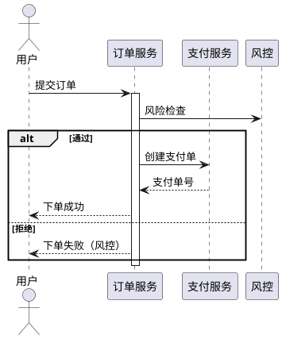
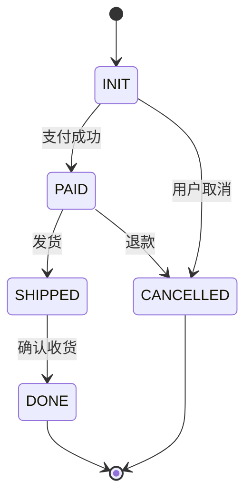

<!--
 * @Author: shgopher shgopher@gmail.com
 * @Date: 2026-10-31 07:40:00
 * @LastEditors: shgopher shgopher@gmail.com
 * @LastEditTime: 2026-10-31 07:40:00
 * @FilePath: /luban/v2/附录/80-架构文档与表达/80.4-时序图与状态图.md
 * @Description: 
 * 
 * Copyright (c) 2026 by shgopher, All rights reserved. 
-->
# 80.4 时序图与状态图

## 一句话

> 时序图回答“**一次请求按什么顺序经过谁**”，状态图回答“**一个实体能处于哪些状态、怎么迁移**”——一张图只答一个问题；画过了、画错了，比不画更糟。

## 先破除三个误区

| 误区 | 现实 |
|---|---|
| 图越全越好 | 图的信息量必须匹配读者的问题；无关细节会把关键路径埋掉 |
| 时序图 = 调用链截图 | 时序图的价值在**顺序与边界**（谁发起、谁等待、失败在哪一步） |
| 状态图 = 流程图 | 流程图讲“步骤”，状态图讲“状态与事件”；混用会画出无法实现的迁移 |

## 时序图：一次请求的“顺序 + 边界”

画的时候只回答四个问题：

| 问题 | 图上怎么体现 |
|---|---|
| 谁发起、谁接收 | 参与者（participant）排在顶部，顺序即调用顺序 |
| 消息的先后 | 箭头从上到下；**同步调用用实线，异步/单向用虚线** |
| 谁在等待 | 激活条（activation）覆盖处理期间 |
| 失败发生在哪 | 用分支（alt/else）标出超时、失败与补偿路径 |



三条经验：

- **一次请求一张图**，不要把所有接口画进一张；
- **失败路径必须画**（超时、重试、补偿），它才是评审要看的；
- 业务逻辑是复杂 SQL 时，画时序图意义不大——原文明确反对这种“用图代替 SQL”的做法。

## 状态图：实体的“生命周期”

状态图回答的是：这个实体在生命周期里能处于哪些状态、什么事件驱动迁移、哪些迁移不允许。



画完必须做三项检查：**有没有不可达状态、有没有无出口且非终态的状态、终态是否齐全**。这三项可以脚本化：

```go
// 状态机检查：不可达状态、无出口且非终态、缺终态。
if !reach[s] { fmt.Printf("✗ 不可达状态：%s\n", s) }
if tos, ok := edges[s]; ok && len(tos) == 0 && s != "DONE" && s != "CANCELLED" {
	fmt.Printf("✗ 无出口且非终态：%s\n", s)
}
```

真实输出（本机 `go1.27.1 darwin/arm64`）：

```text
检查完成：4 个状态可达，2 个终态
```

如果输出里出现“不可达状态”，通常意味着**有个状态只存在于文档里**（代码里没有入口）；出现“无出口且非终态”，意味着**订单会永远卡在这个状态**——这两类问题在评审时看不出来，跑一遍检查就露馅。

## 两张图与 C4 的分工

| 图 | 回答 | 读者 | 主场 |
|---|---|---|---|
| 上下文图 / 容器图 | 系统边界与部署单元 | 所有人 | [80.1 C4 模型](80.1-C4模型.md)、[80.2 架构图规范](80.2-架构图规范.md) |
| **时序图** | 一次请求的顺序与失败点 | 开发、测试、SRE | 本节 |
| **状态图** | 一个实体的生命周期 | 开发、产品、测试 | 本节 |

> 🔑 判断该画哪张：**问“顺序”就画时序图，问“可能性”就画状态图**。同一段业务里两者常常都要：下单是时序（谁调谁），订单状态是状态机（能去哪儿）。

## 反模式

| 反模式 | 后果 |
|---|---|
| 一张时序图画 20 个参与者 | 重点被淹没，评审无法判断关键路径 |
| 只画成功路径 | 失败与补偿没人设计，上线后才发现 |
| 状态图缺终态 | 数据永远“处理中”，需要人工兜底 |
| 用流程图代替状态图 | 画出不可能的迁移（如“已发货”回到“待支付”） |
| 图与代码不一致 | 图变成误导，读者按图改代码出 bug |
| 复杂 SQL 画成时序图 | 信息密度低，SQL 本身反而没写 |
| 状态机没有守卫条件 | 任何事件都能迁移，状态失去意义 |

## 自检

**Q1** 什么时候该画时序图，什么时候该画状态图？

▸ 答案：问“顺序”画时序图（一次请求经过谁、谁等谁、失败在哪一步）；问“可能性”画状态图（这个实体能处于哪些状态、什么事件能迁移、哪些迁移不允许）。同一业务常常两者都要：下单流程是时序，订单状态是状态机。

**Q2** 时序图为什么必须画失败路径？

▸ 答案：因为评审真正要确认的是“失败时系统怎么办”：超时后重试还是降级、补偿由谁发起、用户看到什么。只画成功路径的时序图，等于把最贵的部分留给上线后即兴发挥。

**Q3** 状态图的三项检查分别能发现什么问题？

▸ 答案：**不可达状态**说明有个状态只存在于文档里（代码里没有入口）；**无出口且非终态**说明实体会永远卡住（订单一直“处理中”）；**缺终态**说明流程没有收敛点，需要人工兜底。三项都能脚本化，比人眼评审可靠。

**Q4** 为什么“复杂 SQL 画成时序图”是反模式？

▸ 答案：因为信息密度不对等：SQL 的关键在查询计划、索引、锁；画成时序图只会得到一堆“查询→返回”的箭头，真正的风险一个都没表达。原文的态度很明确：这种情况下直接写 SQL 更有用。

**Q5** 图和代码不一致时，以哪个为准？

▸ 答案：以代码为准，并**立刻修图**。图是辅助表达，代码是唯一可执行的真相；不一致的图比没有图更糟，因为它会误导下一个读者按错误的理解改代码。可以的话，让图从代码/契约生成，减少漂移。

## 关联

- 前置：[80.1 C4 模型](80.1-C4模型.md)、[80.2 架构图规范](80.2-架构图规范.md)
- 并列：[80.3 架构设计文档模板](80.3-架构设计文档模板.md)、[80.5 技术方案写作](80.5-技术方案写作.md)
- 下游：[44.10 事务与隔离级别的实现](../../L4-组件与技术/44-数据库/44.10-事务与隔离级别.md)（状态迁移与事务边界）
