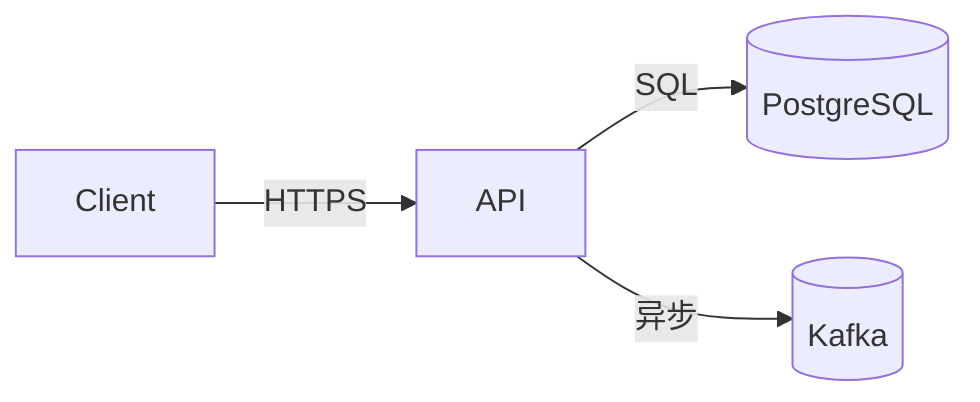

<!--
 * @Author: shgopher shgopher@gmail.com
 * @Date: 2026-11-23 14:30:00
 * @LastEditors: shgopher shgopher@gmail.com
 * @LastEditTime: 2026-11-23 14:30:00
 * @FilePath: /luban/v2/附录/83-架构文档与表达/83.7-Agent画架构图.md
 * @Description: 
 * 
 * Copyright (c) 2026 by shgopher, All Rights Reserved. 
-->
# 83.7 用 Agent 画架构图：可 diff、可校验

## 一句话

> 架构图的价值不在「画得漂亮」，而在**跟代码同源、能 diff、能校验**；Agent 时代的变化是图从绘图文件变成文本 / HTML / SVG 源，图和代码可以进同一个 PR——但「生成得快」不等于「画得对」，校验和人审不能省。

## 先破除五个误区

| 误区 | 现实 |
|---|---|
| 图是给人看的，不需要版本 | 图和代码不同步，半年后没人信；文本图能 diff、能 review、能进 CI |
| AI 画得快就能信 | 模型会补不存在的组件、连错方向；每个框都要能对应到代码或部署单元 |
| 一张图塞下所有层 | 上下文、容器、组件混在一起，读者不知道看哪层；一张图只回答一个问题 |
| 交互图一定比静态图好 | 交互适合讲路径；评审、打印、diff 仍要静态源与稳定输出 |
| 生成 SVG 不用校验 | 坐标、文字溢出、箭头穿框、中文豆腐块，肉眼很难全查；需要 linter |

## 图是代码的一部分

在 Markdown 里写一个 Mermaid 代码块，GitHub / GitLab 会直接渲染。这意味着图和代码可以住在同一个 PR：



好处不是「省了绘图工具」，而是：

- **可 diff**：改了一个依赖方向，review 里能看到一行文本变化；
- **可 review**：图的问题和代码的问题在同一条评论里说；
- **可生成**：Agent 读代码库，输出文本图；
- **可校验**：语法、链接、节点命名、元素数量都能进 CI。

传统工具（draw.io、Excalidraw）没有消失，但它们的产物是二进制/文件，Agent 只能整文件读写，人只能手拖。**文本图让人和 Agent 改的是同一种东西**。

## 四种图，四种工序

| 形态 | 适合 | 不适合 | 代表 |
|---|---|---|---|
| **文本图**（Mermaid / PlantUML） | PR 内更新、C4、时序、状态 | 高定制视觉、复杂版式 | 83.2 的 PlantUML 示例 |
| **静态编辑级图**（HTML/SVG） | 对外文档、方案评审、品牌化配图 | 频繁小改（除非有源） | diagram-design |
| **交互式图**（单文件 HTML） | 讲一次请求的路径、按场景切换 | 打印、纯文本 review | archify / architecture-diagram-skill |
| **手写 SVG + linter** | 像素级可控、可审查、可进 PDF | 快速草图 | svg-diagram |

## 五个画图 Skill

| Skill | 解决什么 | 机制 | 产物 |
|---|---|---|---|
| **diagram-design**（cathrynlavery） | 编辑级静态图 | 40+ 图型、三种变体（浅色/深色/编辑风）、读网站配品牌；哲学是「最高质量的动作是删除」 | 自包含 HTML + SVG |
| **archify**（tt-a1i） | 会动的图 | 命名视图、路径高亮、lens 聚焦、章节播放；可从代码库生成带出处的图 | 单文件交互 HTML |
| **architecture-diagram-skill**（konraddzbik） | 轻量交互 | 场景 tab、数据包沿链路动画、侧栏 payload/延迟、dev/prod 切换 | 单 HTML |
| **svg-diagram**（bybit-exchange） | 可控、可校验 | 版式写成算术：盒高、基线、箭头间距、中文宽度表；`svg-lint` 12 项检查 | 纯 SVG |
| **/insight-diagram**（goal-workflow） | 从代码出发 | 分析代码库，列 17 种图，默认「架构 + 序列 + 流程」三张 | HTML + SVG，存 `docs/` |

安装入口（以各仓库 README 为准）：

```bash
# diagram-design：Claude Code 插件市场
/plugin marketplace add cathrynlavery/diagram-design

# archify（README 当前写法，按你的 Agent 选 --agent）
npx -y skills@latest add https://archify.si --skill archify --agent claude-code --global --copy --yes

# svg-diagram
npx skills add bybit-exchange/svg-diagram -g
```

> 数据与工具能力来自 [《AI 时代的软件工程》第 43 章](https://se.rpcx.io/43.html)；版本与安装方式会漂，执行前看仓库。

## 选型：按「图要回答什么」查

| 你要回答 | 选什么 | 理由 |
|---|---|---|
| 系统边界、谁依赖谁 | Mermaid / PlantUML 的 C4 上下文图 | 文本、可 diff、元素少 |
| 对外方案 / 评审配图，要好看 | diagram-design | 编辑级版式，读品牌色，先删后画 |
| 一次请求怎么走、按场景切换 | archify / architecture-diagram-skill | 路径高亮、tab、单文件分发 |
| 像素级可控、要 lint、要进 PDF | svg-diagram | 坐标是字面量，规则可检查 |
| 从代码库反推架构 | /insight-diagram | 图上每个框对应代码里存在的东西 |
| 大 PR 的影响面 | PR Lens（见 [51.6 AI 代码审查](../../L5-工程效能/51-版本与协作/51.6-AI代码审查.md)） | 爆炸半径 + 数据流 |

## 质量门禁：图也要过 CI

一张能进仓库的图，至少过五关：

| 关卡 | 检查 | 怎么做 |
|---|---|---|
| 语法 | Mermaid/PlantUML 能渲染 | CI 渲染一次；坏图直接失败 |
| 结构 | 一张图只回答一个问题；元素数在上限内 | 上下文 ≤15、容器 ≤20、组件 ≤25（[83.2 架构图规范](83.2-架构图规范.md)） |
| 事实 | 每个节点/箭头都能对应代码或部署单元 | 生成后人工对照仓库；禁止「模型补的组件」 |
| 版式 | 字不溢出、箭头不穿框、中文不豆腐块 | `svg-lint`；深色模式与 PDF 各看一次 |
| 时效 | 图和代码同一个 PR 更新 | 代码改依赖，PR 里必须改图；过期图删除 |

一条能抄的检查命令（svg-diagram 项目）：

```bash
node ~/.claude/skills/svg-diagram/tools/svg-lint/bin/svg-lint.mjs docs/diagrams/arch.svg
```

Codex/Cursor 等共享 `~/.agents/skills/svg-diagram/` 路径；它的报错会直接给「现在的值 → 应该的值」，例如 `viewBox: 11 → 20-25`，这比「看起来有点歪」可执行得多。

## 从代码到图：先定源，再渲染

推荐的工作流：

```text
代码 / 部署清单（源）
  → Agent 生成图源（.mmd / .puml / .svg / JSON）
  → 校验（渲染 / svg-lint / schema）
  → 人审（节点是否真实、箭头是否有语义）
  → 渲染产物进 docs/（产物可再生成，不手改）
```

三条纪律：

1. **源文件进 git，渲染产物可再生成**：不要只提交 PNG；PNG 不能 diff，也不能校验。
2. **图与代码同 PR**：改依赖方向、加组件、删服务，同一 PR 改图；否则图必然过期。
3. **每个节点都要「挣到位置」**：删掉不影响理解的框；强调色只留给读者最先要看的一两处。

## 反模式

| 反模式 | 后果 |
|---|---|
| 只提交 PNG / 截图 | 不能 diff、不能校验，改一次重画一次 |
| 让 AI 凭印象补组件 | 图上出现代码里不存在的服务，评审被误导 |
| 一张图塞上下文 + 容器 + 组件 | 读者不知道看哪层；违反「一张图一个问题」 |
| 节点 50+、字号缩小 | 认知负荷爆炸；应拆子域多张图 |
| 箭头无标签、无方向 | 读者不知道传什么、谁调用谁 |
| 交互图当唯一交付 | 打印/评审/归档不可用；静态源仍要有 |
| 生成后不校验 | 文字溢出、箭头穿框、中文豆腐块 |
| 图和代码分两个 PR | 图必然落后，最后没人信 |

## 自检

**Q1** 为什么说「图是代码的一部分」？它带来的三个直接好处是什么？

▸ 答案：图变成文本/源文件后，可以和代码住同一个仓库、同一个 PR。三个好处：可 diff（改动能 review）、可生成（Agent 读代码输出图）、可校验（语法/结构/版式能进 CI）。只提交 PNG 则三者都没有。

**Q2** 静态图、交互图、手写 SVG 分别该在什么场景用？

▸ 答案：静态文本图适合 PR 内更新与 C4/时序/状态；交互图适合讲一次请求的路径、按场景切换；手写 SVG + linter 适合像素级可控、要进 PDF/文档、要严格校验的场景。它们不是替代关系，常组合：源用文本/SVG，交互版由源生成。

**Q3** AI 画图最容易出的事实错误是什么？怎么防？

▸ 答案：补出不存在的组件、连错依赖方向、把外部系统画成内部服务。防法：生成后逐节点对照代码/部署清单；每个箭头写清「谁发起、做什么、什么协议」；图与代码同 PR；关键图人工 review，不把「生成得快」当正确性。

**Q4** 为什么一张图只能回答一个问题？元素上限怎么定？

▸ 答案：上下文图讲边界、容器图讲部署单元、组件图讲职责；混层后读者无法判断该看哪层。元素上限是认知负荷的工程化：上下文 ≤15、容器 ≤20、组件 ≤25；超了应拆子域多张图，而不是缩小字号。

**Q5** svg-diagram 的「版式写成算术」解决了什么问题？

▸ 答案：把盒高、文字基线、箭头间距、中文宽度写成可计算规则，坐标成为带注释的字面量，图就能被 `svg-lint` 逐项检查，也能被 diff/review。代价是前期规则多，收益是稳定、可审查、可进 PDF，不依赖某次模型发挥。

**Q6** 图从代码生成后，为什么还要人审？

▸ 答案：生成器能读代码，但不知道哪些是「重要边界」、哪些是「临时脚本」、哪些外部系统该画。人审负责语义：节点是否真实、层级是否正确、箭头是否表达真实依赖、是否该删除。工具保证语法与版式，人保证图在讲对的故事。

## 关联

- 前置：[83.1 C4 模型](83.1-C4模型.md)、[83.2 架构图规范 (上下文图 / 容器图 / 组件图)](83.2-架构图规范.md)
- 并列：[83.4 时序图与状态图](83.4-时序图与状态图.md)、[51.6 AI 代码审查：从 diff 到证据](../../L5-工程效能/51-版本与协作/51.6-AI代码审查.md)
- 下游：[83.3 架构设计文档模板](83.3-架构设计文档模板.md)、[58.3 架构评审](../../L5-工程效能/58-架构治理/58.3-架构评审.md)

---
